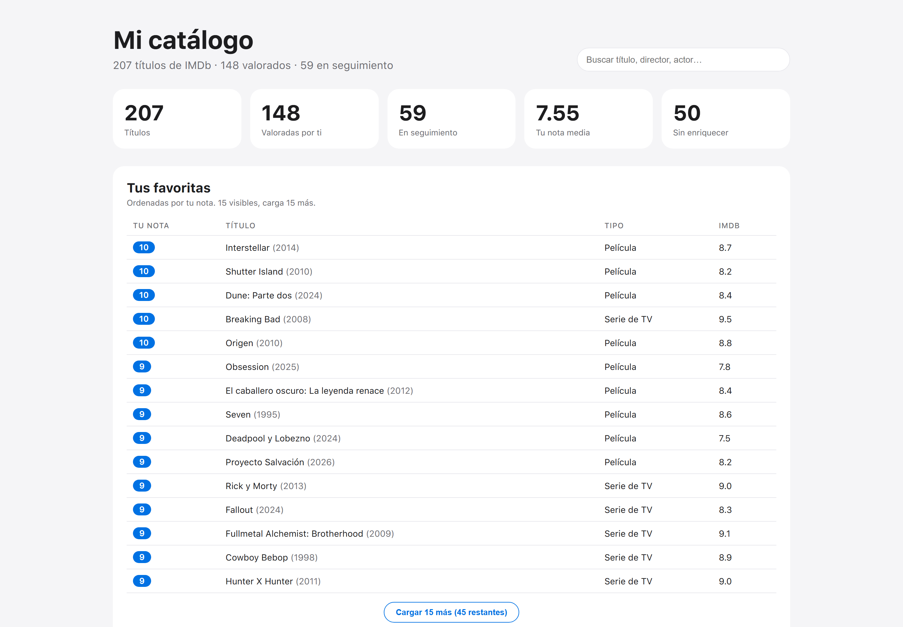

# bd-peliculas

[](https://github.com/AlejandroEscapa/bd-peliculas/actions/workflows/ci.yml)

**Un catálogo personal de IMDb que trata el CSV como un delta, no como la verdad.**

SQLite + Python stdlib. Sin servidor, sin ORM y sin dependencias en tiempo de ejecución.

[**Demo en vivo**](https://bd-peliculas-weld.vercel.app) · [Código](https://github.com/AlejandroEscapa/bd-peliculas) · Python 3.11+ · 35+ tests · Licencia MIT



## Qué es

Importas tu export de IMDb una vez y el catálogo se queda con tus notas. A partir de ahí:

- **Reimportar no destruye nada.** El CSV solo actualiza las columnas que posee; un campo vacío nunca borra una sinopsis, un póster, el reparto ni tu nota. Cada cambio queda auditado en `sync_diffs`.
- **El enriquecido va por huecos.** `huecos.py` calcula qué falta y el scraper pide solo eso a TMDB (es-ES, fallback en-US) y OMDb. Un título roto no aborta el lote.
- **El panel es un fichero estático.** `generar_vista.py` convierte la base en un dashboard HTML sin framework, sin build y sin peticiones al servidor. La paginación es 15 + 15 con JavaScript puro.

El resultado es un catálogo que puedes abrir en local, versionar como snapshot y desplegar en cualquier hosting estático.

## Arquitectura

```text
export de IMDb (.csv)
        │
        ▼
scripts/actualizar_peliculas.py ──▶ src/sync.py ──▶ SQLite
                                                   │
                     ┌─────────────────────────────┼─────────────────────────────┐
                     ▼                             ▼                             ▼
              src/huecos.py                 src/scraper.py              scripts/generar_vista.py
           (qué falta y por qué)      (TMDB + OMDb, solo huecos)      (panel HTML estático)
                     │                             │                             │
                     └──────────────▶ enriquecido en SQLite ─────────────────────┘
                                                   │
                                                   ▼
                                      preview/dashboard.html
                                      (Vercel / GitHub Pages / local)
```

### Tres capas de datos

| Capa | Tablas | Regla |
|---|---|---|
| Título canónico | `titles`, `title_genres`, `title_credits`, `title_cast`, `title_countries`, `release_dates`, `series_info`, `title_relations` | Hechos del título; la web solo rellena huecos |
| Capa personal | `user_state` | `my_rating`, `watch_status`, notas y fechas del CSV |
| Auditoría | `sync_runs`, `sync_diffs`, `import_quarantine` | Cada importación deja rastro; un `tt` inválido va a cuarentena |

La clave estable es el `tt` de IMDb. El esquema completo está en [`db/schema.sql`](db/schema.sql) y las vistas de lectura en [`db/views.sql`](db/views.sql).

## Quickstart

No hay `pip install`. Solo Python 3.11 o superior.

```bash
git clone https://github.com/AlejandroEscapa/bd-peliculas.git
cd bd-peliculas

# 1. La suite, sin instalar nada
python -m unittest discover -s tests

# 2. Crea la base e importa tu export de IMDb
python scripts/actualizar_peliculas.py "C:\ruta\a\tu-export.csv"

# 3. Mira qué falta
python -c "from src.huecos import listar_huecos; import json; print(json.dumps(listar_huecos('data/catalogo.db'), indent=1, ensure_ascii=False))"

# 4. Enriquece solo los huecos (TMDB primero, OMDb de apoyo)
set TMDB_BEARER=<tu-jwt> & set OMDB_API_KEY=<tu-key>
python scripts/scrapear_peliculas.py --proveedor src.proveedores.combinado:ProveedorCombinado --limite 20 --delay 1.5 --dry-run

# 5. Genera el panel y ábrelo
python scripts/generar_vista.py
start preview/dashboard.html
```

En Linux o macOS, cambia `set` por `export` y `start` por `open`. Sin `OMDB_API_KEY` el proveedor combinado funciona solo con TMDB.

### Comandos

| Comando | Qué hace |
|---|---|
| `python scripts/actualizar_peliculas.py <csv>` | Importa un delta y registra diffs y cuarentena |
| `python scripts/scrapear_peliculas.py --proveedor ... --limite N --delay S` | Rellena huecos con pausa entre peticiones |
| `python scripts/generar_vista.py` | Regenera `preview/dashboard.html` |
| `python scripts/auto_vista.py --una-vez` | Regenera el panel una vez; sin `--una-vez`, vigila la BD |
| `python scripts/backup.py` | Vuelca la base a SQL + manifiesto JSON |
| `python -m unittest discover -s tests` | Suite completa |

## Decisiones de diseño

**El CSV es un delta, no la verdad.** El export de IMDb es la entrada, pero no manda sobre todo. `src/sync.py` tiene una lista explícita de columnas CSV-own (`CSV_OWN_TITLES`); el resto del catálogo es enriquecido y protegido. Vacío nunca borra. Los cambios se registran en `sync_diffs`, no se aplican a ciegas.

**Enriquecido por huecos, no por catálogo.** `listar_huecos` devuelve solo lo que falta; el scraper usa `INSERT OR IGNORE` y aísla el fallo por título. Un `429` o un título sin resolver no tumban el lote. TMDB aporta sinopsis, póster, reparto y fechas; OMDb parchea lo que TMDB no cubre.

**Panel estático, no SPA.** El dashboard es un HTML generado: se puede abrir con doble clic, servir desde cualquier CDN y versionar como artefacto. No hay runtime, ni base de datos expuesta, ni claves en el navegador. Las consultas son parametrizadas y todo texto que viene de la BD pasa por `html.escape`.

**Cero dependencias como restricción, no como alarde.** `sqlite3`, `csv`, `json`, `html` y `unittest` cubren todo el producto. Eso simplifica el despliegue y hace que el repo se entienda en una tarde, pero también limita cosas que un framework daría gratis: no hay ORM, ni migraciones automáticas, ni servidor de desarrollo.

## Tests

```bash
python -m unittest discover -s tests
```

35+ tests con `unittest`, sin `pytest` ni dependencias. Cubren esquema y vistas, importación delta y diffs, cuarentena, huecos, proveedores, relaciones, scraper y el HTML generado.

## Demo y datos

La demo pública usa un snapshot de un catálogo real. **Las notas son personales** y el fichero de la base no se versiona (`data/`, `backups/` y `*.db` están en `.gitignore`).

Para reproducir el panel con tus datos, importa tu propio export. El repo no incluye el CSV ni la base.

## Atribución

- Este producto usa la API de TMDB, pero **no está avalado ni certificado por TMDB**.
- Los datos de OMDb se usan bajo su API; las notas y el export original son del usuario.
- Los pósters se enlazan desde `image.tmdb.org`; no se redistribuyen binarios.

## Roadmap

- [ ] Vista de pósters en el panel, manteniendo la paginación 15 + 15.
- [ ] Fase 2 de TMDB: estreno en España, presupuesto/taquilla y detalle de series.
- [ ] CI en GitHub Actions con matriz de Python.
- [ ] Demo reproducible con datos sintéticos.
- [x] Despliegue estático en Vercel y ficha en el portfolio.

La línea multiusuario está aparcada y documentada en [`ROADMAP.md`](ROADMAP.md): el aislamiento físico por usuario choca con los free tiers y no es necesario para un producto personal.

## Licencia

Código bajo MIT. Los datos de IMDb, TMDB y OMDb no se incluyen y quedan sujetos a sus propios términos.
